# Netflix Analytics Dashboard


An interactive dashboard that analyses **Netflix movies and TV shows** and **24 million+ user ratings**.
A big data pipeline built with PySpark and Spark SQL cleans and merges three Kaggle datasets, and a Streamlit
front end lets you explore the results. A **content type toggle** and a **release year slider** update every
chart instantly.

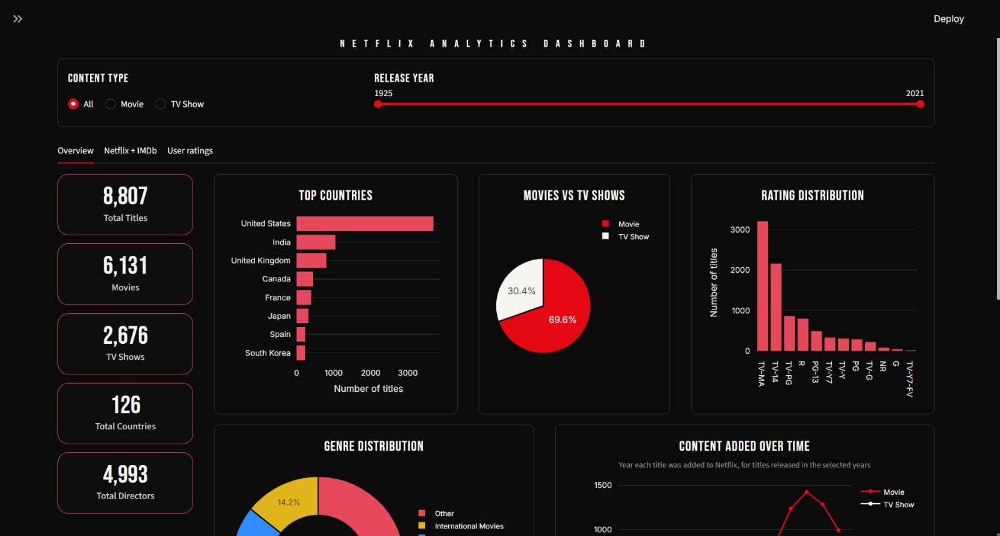

---

## Features

- **Content type toggle:** All, Movie or TV Show.
- **Release year slider:** filter every chart by release year range.
- **Overview tab:** key figures, top countries, movies vs TV shows, rating distribution, genre distribution,
  content added over time and content by release year.
- **Netflix + IMDb tab:** Netflix titles merged with the IMDb Top 1000 list, with top-rated matches and rating charts.
- **User ratings tab:** rating distribution and trends from 24 million+ Netflix Prize ratings.

---

## Screenshots

### Overview (all content)


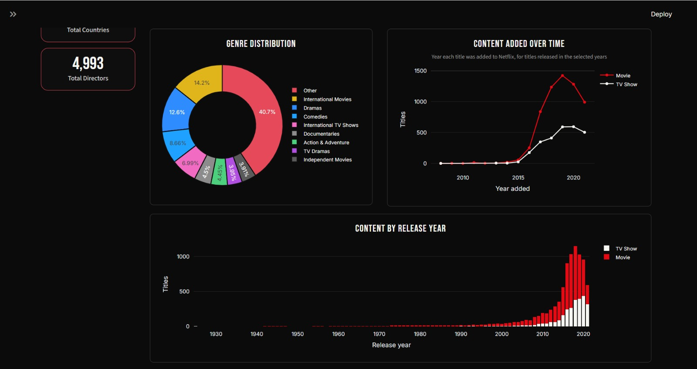

### Content type toggle
**Movies only**

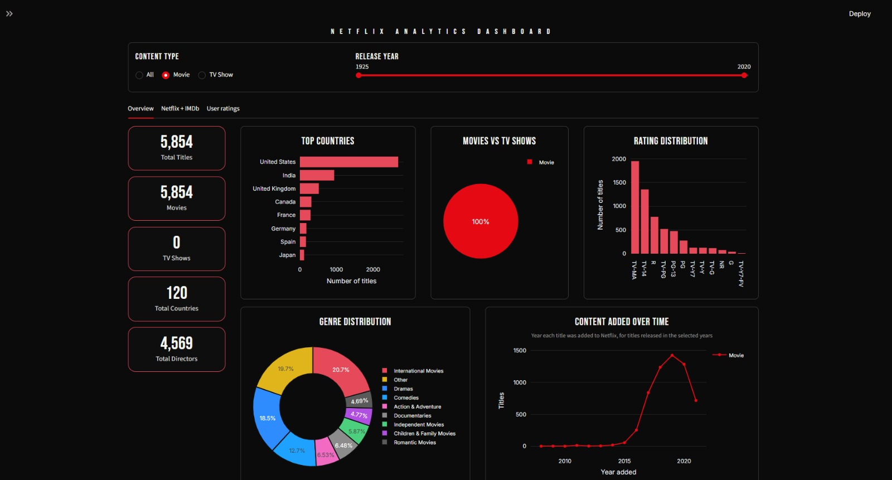

**TV shows only**

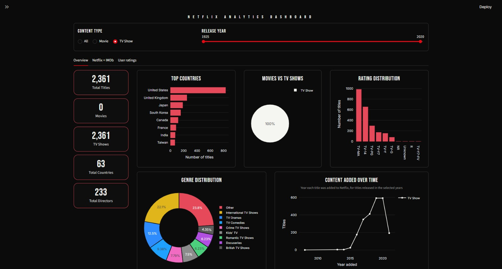

### Release year slider
**Release years 1966 to 1994**

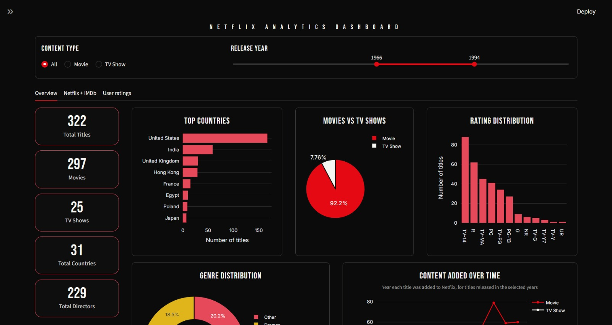

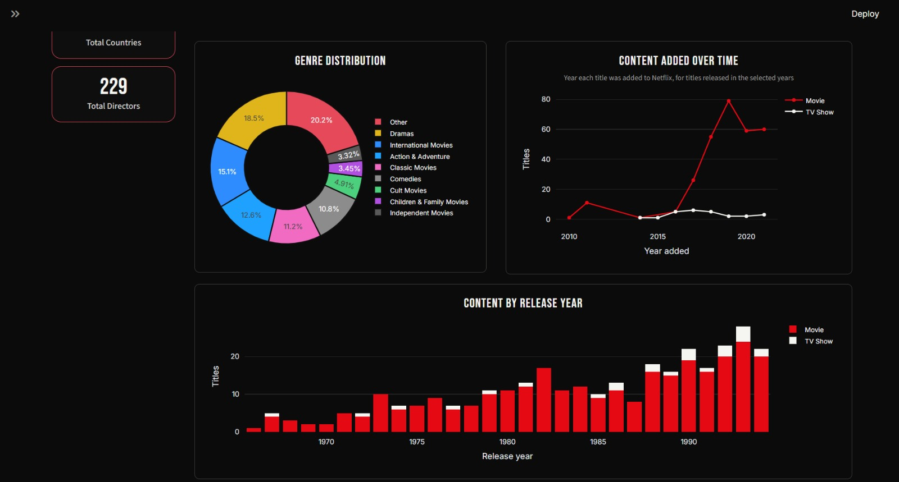

**Release years 1926 to 1954**

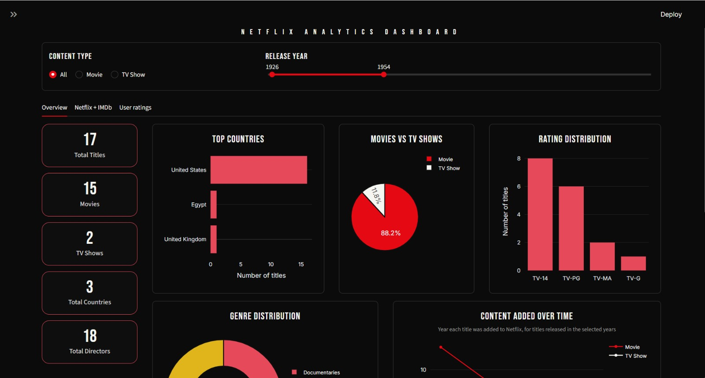

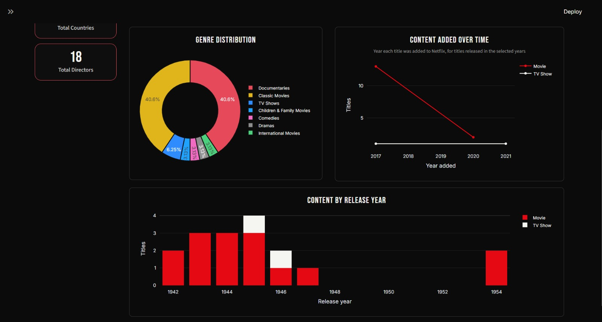

### Netflix + IMDb
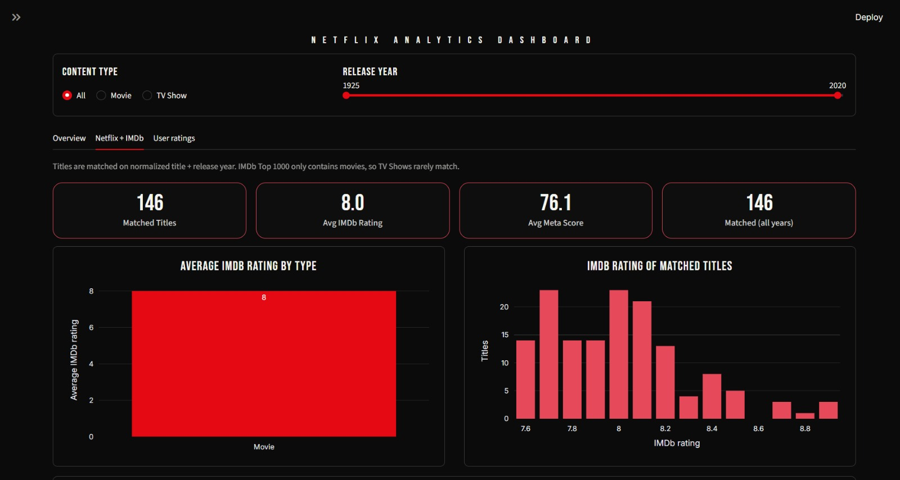

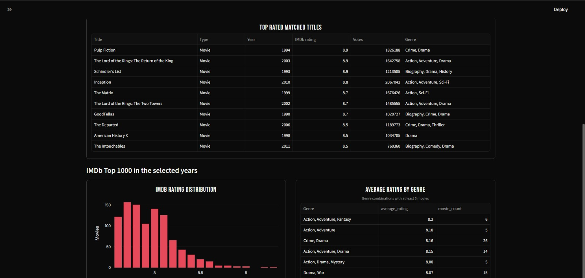

### User ratings (Netflix Prize)
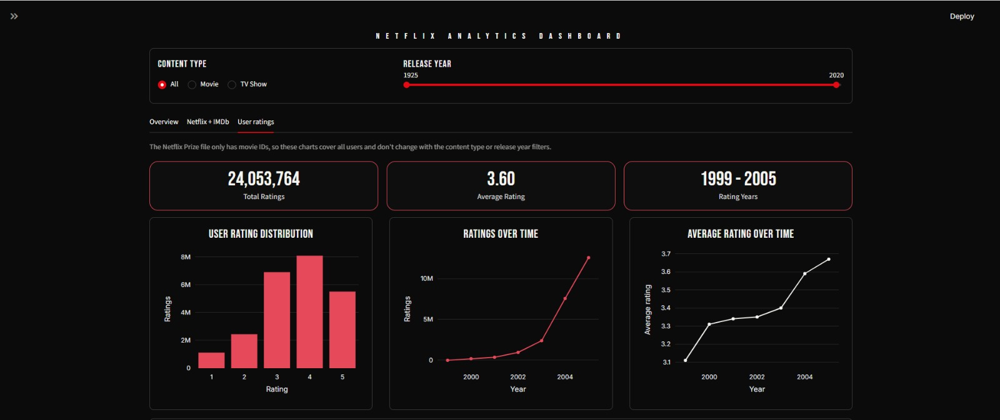

---

## Datasets (from Kaggle)

| Dataset | File | Used for |
|---|---|---|
| Netflix Movies and TV Shows | `netflix_titles.csv` | Content catalogue analysis |
| IMDb Top 1000 Movies | `imdb_top_1000.csv` | Quality benchmark merged with Netflix titles |
| Netflix Prize Ratings | `combined_data_1.txt` | User rating behaviour (24 million+ ratings) |

The data files are **not included** in this repository because they are large. Download them from Kaggle and
place them in a `data/` folder.

---

## Tech Stack

- **Python**
- **PySpark / Apache Spark** for distributed, in-memory processing
- **Spark SQL** for every analysis query
- **Streamlit** for the dashboard and **Plotly** for the charts

---

## How It Works

1. Load the three datasets with PySpark.
2. Detect and remove duplicates, and analyse missing values.
3. Clean the data: trim text, fill gaps, fix data types and remove invalid values.
4. Normalise titles and merge Netflix with IMDb on title and release year.
5. Parse the Netflix Prize file (movie ID lines are carried down to the rating rows with a window function).
6. Run Spark SQL queries. The toggle and slider values are added to the `WHERE` clause, so the charts update.

---

## Key Findings

- 8,807 titles: **6,131 movies (69.6%)** and **2,676 TV shows (30.4%)** from **126 countries**.
- The **United States** leads, followed by India, the United Kingdom, Canada and France.
- **TV-MA** and **TV-14** are the most common ratings.
- Content added to Netflix grew sharply after 2015 and peaked around 2019.
- 146 Netflix movies match the IMDb Top 1000, with an average IMDb rating of 8.0.
- The Netflix Prize data has 24,053,764 ratings with an average of 3.60. A rating of 4 is the most common.

---

## Project Structure

```
netflix-analytics-dashboard/
├── app.py                 # Spark pipeline + Streamlit dashboard
├── requirements.txt
├── README.md
├── .streamlit/
│   └── config.toml        # dark theme
├── screenshots/           # images used in this README
└── data/                  # download from Kaggle (not in the repo)
```

---

## Run Locally

**Requirements:** Python 3.10 or newer and Java 17 or newer (needed by Spark).

```bash
# 1. Create and activate a virtual environment
python -m venv venv
venv\Scripts\Activate.ps1          # Windows PowerShell
# source venv/bin/activate         # Mac / Linux

# 2. Install packages
pip install -r requirements.txt

# 3. Put the three data files in the data/ folder, then run
streamlit run app.py
```

The first load runs the full Spark pipeline and can take a few minutes. Untick **Include Netflix Prize ratings**
in the sidebar for a faster start.

---

## Author

[Your Name] | [College / Department]
